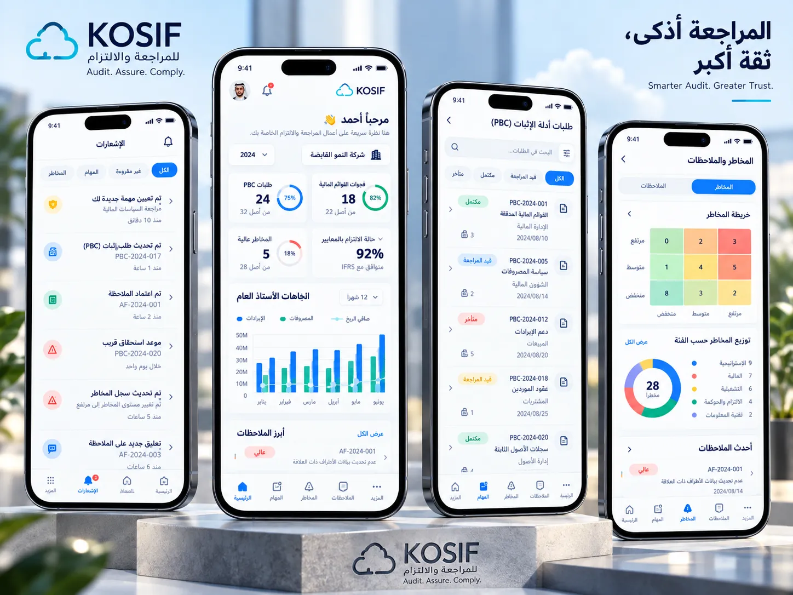

# KOSIF Luxe — نظام التصميم الفاخر

المرجع: التصاميم المعتمدة في `docs/design/mockups/` (الآيفون · لوحة القيادة على اللابتوب · تنفيذ المراجعة).
كل ما يلي مطبّق في الشيفرة ويُبنى في الحزمة الواحدة (`build.py`).

## القرارات — بـ Jev وCanva

| القرار | الخيارات | الاختيار | كيف اتُّخذ |
|---|---|---|---|
| خط الواجهة | IBM Plex Sans Arabic · Tajawal · Almarai · Cairo · Noto Kufi Arabic | **IBM Plex Sans Arabic** | `jev_choice` — احتمال 0.99 (أوضح أرقاماً في الجداول الكثيفة، مع لاتيني مطابق) |
| الشعار اللاتيني KOSIF | — | Montserrat 700–800 | يطابق حروف الشعار في التصاميم |
| الشريط السفلي للجوال | تصميم المراجعة · التشغيل · هجين | **هجين**: الرئيسية · الطلبات · المهام · المخاطر (+ المزيد) | `jev_choice` — احتمال 0.75؛ الإشعارات على الجرس في الأعلى |
| صورة السماء (بطاقة القائمة، شاشة الدخول، غلاف التقرير) | — | سماء ركامية فوق كحلي KOSIF | وُلّدت في Canva (الوسيط `MAHWPvhoRuY`) ثم أُعيد رسمها متجهياً في `ui/art/kosif-sky.svg` (2.6 ك.ب، حادة بأي مقاس) لأن بيئة البناء لا تصل لخوادم تنزيل Canva |
| قيمة أفكار التطوير | 12 فكرة | مرتبة في `docs/ROADMAP-ar.md` | `jev_score` لكل فكرة على مقياس 0–4 مع درجة الثقة |

## الألوان (`ui/ds/tokens.css` → `:root[data-look="kosif"]`)

| الرمز | القيمة | الاستخدام |
|---|---|---|
| `--sk-rail` / `--sk-grad-rail` | `#0b1f3a` → `#0d2848` | القائمة الجانبية الكحلية |
| `--sk-brand` | `#1668e3` | أزرق KOSIF: الأزرار، الروابط، الحلقات |
| `--sk-brand-2` | `#22b8e6` | سماوي السحابة: المؤشر النشط، خط الصافي |
| `--sk-bg` · `--sk-surface` | `#f3f6fa` · `#ffffff` | أرضية باردة وبطاقات بيضاء |
| `--sk-ok` · `--sk-warn` · `--sk-bad` | `#12884a` · `#b86204` · `#d3322a` | مكتمل · متوسطة/قيد المراجعة · عالي/متأخر |
| `--sk-heat-1…4` | أخضر · أصفر · برتقالي · أحمر | خريطة المخاطر 3×3 |

الوضع الليلي «KOSIF الليلي» يعيد تعريف الرموز نفسها؛ الثيمات الأخرى (تراث الوادي، التنفيذي، …) تأخذ البنية نفسها بألوانها.

## الهيكل

| عنصر التصميم | الملف |
|---|---|
| الشريط العلوي: الشركة ▾ · الفترة ▾ · البحث ⌘K · الجرس · الاسم واللقب والصورة الرمزية | `ui/layouts/topbar.js` + `ui/ds/luxe.css` |
| رأس الصفحة: أيقونة · العنوان · الاسم الإنجليزي (`en` في السجل) · الوصف · إجراءات الشاشة | `ui/layouts/topbar.js` |
| القائمة الكحلية مع بطاقة «مراجعة أذكى. ثقة أكبر.» | `ui/ds/shell.css` + `ui/ds/luxe.css` |
| رأس الجوال: KOSIF · بحث · جرس · صورة رمزية، ورقاقتا الشركة والسنة تحت التحية | `ui/ds/luxe.css` (≤ 900px) |
| بطاقات المؤشرات بأيقونة وحلقة تقدّم «من أصل N» | `.skk4` + `SKCharts.ring` |
| أعمدة مجمّعة مع خط صافٍ وتلميح | `SKCharts.bars` (`ui/components/charts.js`) |
| خريطة المخاطر · التوزيع الدائري · أشرطة التقدّم · الخط الزمني | `SKCharts.heatmap/donut/progress` · `.sktl` |
| جداول «ميزان المراجعة»: بحث · فرز · «عرض الأعمدة» · تصدير · ترقيم الصفحات · ▲▼ للتغير | `ui/components/table.js` (يطوّر كل جداول التطبيق تلقائياً) |
| شارات الأثر والحالة: عالي · متوسطة · منخفض · مكتمل · قيد المراجعة · متأخر | `.sksev` |
| ترويسة الطباعة: شريط كحلي، سحابة KOSIF، ترقيم «صفحة X من Y» | `SK.brandPrint` (`ui/core/sk.js`) |

## الشاشات الجديدة والمعاد تصميمها

- **مركز القيادة**: تحية «مرحباً {الاسم} 👋» بالتاريخين، أربع بطاقات بحلقات، اتجاهات المبيعات والمشتريات (6/12 شهراً)، خريطة المخاطر، بنية التدفق، ما يحتاج قراراً بشارات الأثر، حالة المهام، النشاطات الحديثة، ابدأ عملاً.
- **مركز الإشعارات** (`notifications`): فلاتر الكل · غير مقروءة · المهام · المخاطر · التنبيهات · النظام، مجمّعة حسب اليوم، مع عدّاد على الجرس.
- **المخاطر والملاحظات** (`risks`): سجل مخاطر بالاحتمالية × الأثر، خريطة حرارية تصفّي السجل، توزيع حسب الفئة، تحويل تنبيهات التطبيق إلى خطر، ملاحظات AF-السنة-التسلسل بالأثر والحالة، تصدير وطباعة.
- **الحزمة التنفيذية** (أول تبويب في التقارير التنفيذية): غلاف بسماء KOSIF، ملخص، رسم وجدول شهري، مخاطر، ملاحظات، قرارات، مهام، واعتماد بثلاثة توقيعات.
- **شاشة الدخول**: بطاقة بيضاء بجانب لوحة السماء «المراجعة أذكى، ثقة أكبر — Smarter Audit. Greater Trust.».

## القواعد

- لا أرقام مصطنعة: كل رقم من سجلات التطبيق، والمصدر الفارغ يعرض حالة فارغة.
- الألوان من الرموز فقط؛ الجداول تُطوَّر بلا تعديل على الشاشات (خيار الانسحاب: `data-sk-plain`).
- الأرقام بأرقام لاتينية جدولية (`tnum`)، والزمن في الرسوم من اليسار لليمين كما في التصاميم.
