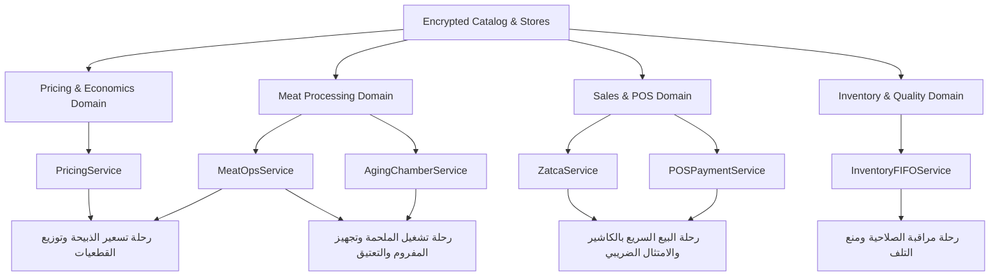

# خريطة القدرات الهندسية ومجالات العمل — Phase 2: Capability & Domain Map
**مشروع S.kosif**  
**تاريخ التوثيق:** 25 سبتمبر 2026  
**المرجع:** MASTER REBUILD DIRECTIVE (المرحلة 2)

---

## 1. فلسفة خريطة القدرات (Capability Map Philosophy)
القدرة في S.kosif ليست مجرد "صفحة أو شاشة"، بل هي **إمكانية وظيفية حقيقية تمكّن المستخدم من إنجاز هدف تشغيلي أو مالي أو إنتاجي محدد**.

---

## 2. جرد القدرات الفعلي (Capability Inventory Table)

| المعرف | القدرة الفعلية (Capability) | هدف المستخدم (User Goal) | المجال (Domain) | الخدمة النواة (Core Service) | مصدر البيانات | المدخلات الرئيسية | المخرجات الناتجة | التكرار | درجة الحرجية |
|---|---|---|---|---|---|---|---|---|---|
| **CAP-POS-01** | إصدار فاتورة ZATCA | بيع وتوثيق عملية شراء لحوم ضريبياً | `Sales & POS` | `ZatcaService` | `Invoices Store` | الأصناف، الأوزان، الأسعار، العميل | فاتورة ضريبية، QR TLV Base64 | مستمر | **قصوى** |
| **CAP-POS-02** | تقسيم السداد وحساب الفكة | سداد الفاتورة بطرق دفع متعددة | `Sales & POS` | `POSPaymentService` | `Invoices Store` | النقد، مدى، التحويل، الآجل | إجمالي المدفوع، الفكة، الرصيد | مستمر | **قصوى** |
| **CAP-POS-03** | فك شفرة وفحص TLV | التحقق من صحة الفواتير الضريبية | `Compliance` | `ZatcaService` | In-Memory | رمز QR أو نص Base64 | تفاصيل التاجات، تحقق رياضي | يومي | **عالية** |
| **CAP-PRC-01** | احتساب تكلفة الكيلو بعد الهدر | معرفة التكلفة الحقيقية لقطعيات اللحم | `Pricing & Costing` | `PricingService` | `Encrypted Catalog` | سعر الشراء الخام، نسبة الهدر | التكلفة الصافية القابلة للاستخدام | يومي | **قصوى** |
| **CAP-PRC-02** | تسعير الصناديق والبكجات | حساب تكلفة بكجات المشاوي متعددة المكونات | `Pricing & Costing` | `PricingService` | `Catalog + Boxes` | مكونات البكج، التغليف، المصروفات | إجمالي التكلفة، الهامش، سعر البيع | أسبوعي | **عالية** |
| **CAP-PRC-03** | توزيع التكلفة المشتركة NRV | تسعير القطعيات المختلفة من الذبيحة الواحدة | `Meat Economics` | `PricingService` | `Cuts Store` | وزن وتكلفة الذبيحة، أسعار البيع | التكلفة المحملة لكل قطعية | يومي | **قصوى** |
| **CAP-MEAT-01** | حساب نسبة التصافي للذبيحة | معرفة العائد من الوزن الحي إلى المعلق | `Meat Economics` | `MeatOpsService` | `MeatOps Store` | الوزن الحي، وزن الذبيحة المعلقة | نسبة التصافي (Dressing %)، الفاقد | يومي | **عالية** |
| **CAP-MEAT-02** | أمر تشغيل وتشفية الذبيحة | إرشاد الجزار في تفكيك وتوزيع القطعيات | `Butchery Operations` | `MeatOpsService` | `Carcass Archetypes` | أوزان ونسب القطعيات | أمر تشغيل طباعي، توجيهات التشفية | يومي | **عالية** |
| **CAP-AGE-01** | رصد فاقد تبخر التعتيق | متابعة خسارة الوزن اليومية في غرف التعتيق | `Aging Operations` | `AgingChamberService` | `Aging Batches` | رقم الدفعة، وزن الدخول، الوزن الحالي | نسبة التبخر، فاقد الرطوبة | يومي | **عالية** |
| **CAP-AGE-02** | تسعير اللحوم المعتقة بعد التقشير | احتساب تكلفة اللحم الصافي بعد إزالة القشرة | `Aging Operations` | `AgingChamberService` | `Aging Batches` | الوزن المعتق، وزن قشرة Pellicle | التكلفة الحقيقية للكيلو الصافي | دوري | **عالية** |
| **CAP-BLD-01** | أمر خلط اللحم المفروم | إنتاج برجر/كباب بنسب دهن محددة (80/20) | `Butchery Operations` | `BlendingService` | In-Memory | الوزن المطلوب، نسبة الدهن المستهدفة | أوزان اللحم الهبر والشحم، أمر مفرمة | يومي | **عالية** |
| **CAP-INV-01** | رادار الصلاحية FIFO | مراقبة تواريخ الذبح وتفادي تلف اللحوم | `Inventory & Quality` | `InventoryFIFOService`| `Expiry Radar Store`| الدفعة، تاريخ الذبح، نوع التبريد | الأيام المتبقية، مؤشر الخطر | يومي | **قصوى** |
| **CAP-LBL-01** | توليد باركود الموازين | طباعة ملصق الوزن والسعر للكيلو والتجزئة | `Packaging` | `LabelService` | `Scale Registry` | كود الصنف، الوزن، السعر الإجمالي | باركود EAN-13/Code128 SVG | مستمر | **عالية** |
| **CAP-LBL-02** | مسح الباركود بالكاميرا | إدخال الأصناف السريع في الكاشير | `Sales & POS` | `ScannerService` | In-Memory | صورة الكاميرا أو القارئ الضوئي | تفكيك كود الصنف والوزن والسعر | مستمر | **عالية** |
| **CAP-CHEF-01** | إصدار بطاقة نصائح الطهي | توعية العميل بدرجة الاستواء وحرارة اللحم | `Customer Experience` | `CulinaryService` | `Chef Presets` | نوع القطعية، درجة الاستواء المطلوبة | بطاقة حرارة اللب والراحة والطهي | يومي | **متوسطة** |
| **CAP-CAT-01** | تقدير ولائم الشواء والمناسبات | حساب كميات اللحوم والذبائح المطلوبة للأفراد | `Catering & Events` | `CateringService` | In-Memory | عدد الضيوف، وجبة خفيفة/دسمة | إجمالي اللحم المطلوب بالكجم، التكلفة | أسبوعي | **متوسطة** |
| **CAP-B2B-01** | مراقبة أعمار الذمم الائتمانية | متابعة مستحقات المطاعم والفنادق | `Credit & Finance` | `AccountingService` | `AR Store` | كشف الفواتير، المدفوعات | مصفوفة أعمار الذمم (30-60-90 يوم) | أسبوعي | **عالية** |
| **CAP-SUP-01** | تقييم وتتبع الموردين | اختيار المورد الأفضل للمواشي واللحوم | `Procurement` | `SupplyService` | `Suppliers Store` | عروض الأسعار، الجودة، الالتزام | مؤشر تقييم المورد، متوسط التكلفة | أسبوعي | **متوسطة** |
| **CAP-REP-01** | تقارير الإيرادات التنفيذية | استعراض الرسوم البيانية لأداء المبيعات | `Executive Analytics` | `AnalyticsService` | `Invoices + Daily Store`| الفترة الزمنية | رسم بياني SVG، إجمالي المبيعات | يومي | **عالية** |
| **CAP-JEV-01** | استشارة المستشار المالي Jev | استنباط رؤى مالية ذكية مع حماية الأسرار | `AI Advisory` | `DataPrivacyService` | In-Memory Context | الاستفسار المالي أو التشغيلي | إجابة استشارية بدون تسريب خصوصية | دوري | **متوسطة** |
| **CAP-SEC-01** | فك تشفير وتأمين البيانات | حماية الكتالوج والأسعار عبر كلمة المرور | `System Security` | `CryptoEngine` | `secure/crypto.json` | رمز المرور | مساحة عمل آمنة، بيانات مفكوكة | عند الفتح| **قصوى** |
| **CAP-SYS-01** | النسخ الاحتياطي والاستعادة | حفظ بيانات الملحمة محلياً واسترجاعها | `System Data` | `StorageRepository` | `LocalStorage Dump` | ملف JSON | ملف نسخة احتياطية مشفر ونظيف | أسبوعي | **عالية** |

---

## 3. تصنيف القدرات (Capability Classification)

- **CORE (القدرات الجوهرية):**
  - `CAP-SEC-01` (حماية وفك تشفير البيانات)
  - `CAP-PRC-01` (حساب تكلفة الكيلو بعد الهدر)
  - `CAP-PRC-03` (توزيع التكلفة المشتركة للذبيحة NRV)
  - `CAP-POS-01` (إصدار فواتير ZATCA الضريبية)
- **DAILY OPERATIONS (العمليات اليومية للكاشير والجزارين):**
  - `CAP-POS-02` (السداد المتعدد وحساب الفكة)
  - `CAP-LBL-01` (طباعة ملصقات الموازين)
  - `CAP-LBL-02` (مسح الباركود بالكاميرا)
  - `CAP-INV-01` (رادار مراقبة الصلاحية FIFO)
  - `CAP-MEAT-02` (أمر تشغيل وتشفية الذبيحة)
  - `CAP-BLD-01` (أمر خلط وفرم اللحوم)
- **ADVANCED (العمليات التخصصية والمتقدمة):**
  - `CAP-AGE-01` و `CAP-AGE-02` (غرف تعتيق اللحوم الجافة والرطبة)
  - `CAP-PRC-02` (تسعير بكجات التوفير والمشاوي)
  - `CAP-CAT-01` (حاسبة ولائم الشواء والمناسبات)
  - `CAP-POS-03` (أداة فك شفرة TLV الضريبي)
- **MANAGEMENT & FINANCE (الإدارة والمالية):**
  - `CAP-B2B-01` (أعمار الذمم والعملاء التجاريين)
  - `CAP-SUP-01` (إدارة وتقييم الموردين)
  - `CAP-REP-01` (التقارير التنفيذية والرسوم البيانية)
- **INTELLIGENCE & ADVISORY (الذكاء والاستشارات):**
  - `CAP-JEV-01` (مستشار الذكاء الاصطناعي مع حجب الخصوصية)
  - `CAP-CHEF-01` (بطاقات نصائح الطهي لعملاء الذواقة)
- **SYSTEM & UTILITIES (النظام والبيانات):**
  - `CAP-SYS-01` (النسخ الاحتياطي والاستعادة الفورية)

---

## 4. مجالات العمل الطبيعية (Domain Architecture)

1. **مجال البيع ونقاط الكاشير (Sales & POS Domain):**  
   يضم إصدار الفواتير، تقسيم المدفوعات، قراءة الباركود، التحقق الضريبي، بطاقات الشيف.
2. **مجال الجزارة والتصنيع والتشغيل (Meat Processing & Butchery Domain):**  
   يضم تجارب التشفية، خريطة تفكيك الذبيحة، أوامر التشفية، خلط المفروم، غرف التعتيق، الشواء.
3. **مجال المخزون وتتبع الصلاحية (Inventory & Freshness Domain):**  
   يضم رادار الصلاحية FIFO، أصناف الثلاجات، ملصقات الموازين، درجات التبريد.
4. **مجال التسعير والاقتصاديات (Pricing & Economics Domain):**  
   يضم احتساب الهدر، توزيع NRV، تسعير الصناديق، سياسات التقريب التجاري.
5. **مجال المالية والشركاء (Finance & Partners Domain):**  
   يضم أعمار الذمم B2B، تقييم الموردين، الرسوم البيانية، التحليلات اليومية.

---

## 5. مصفوفة القرارات (Decision Matrix)

| القدرة | القرار المتخذ | السبب الفني والتشغيلي |
|---|---|---|
| `CAP-POS-01` (ZATCA POS) | **UPGRADE** | تحديث واجهة الكاشير لتكون كاملة الاستجابة على الجوال والتابلت مع شريط سداد فوري. |
| `CAP-POS-02` (Split Payments) | **UPGRADE** | دمج خيارات السداد في نافذة كاشير حديثة مع حساب الفكة تلقائياً. |
| `CAP-MEAT-02` (Carcass Anatomy) | **UPGRADE** | تفعيل خريطة تشريح الذبيحة SVG مع نماذج الذبائح السعودية الجاهزة. |
| `CAP-AGE-01` (Aging Chamber) | **UPGRADE** | ربط فاقد التعتيق بحساب التكلفة الفعالة تلقائياً وتصدير بطاقة تعتيق للملصقات. |
| `CAP-PRC-01..03` (Pricing Engines) | **KEEP** | الحفاظ 100% على النواة الرياضية الصارمة بدون أي تعديل حسابي. |
| `CAP-SYS-01` (JSON Backup) | **UPGRADE** | إضافة فحص سلامة البيانات (Schema Validation) عند الاسترجاع لمنع الأخطاء. |

---

## 6. القدرات الخفية المكتشفة (Hidden Capabilities)

1. **أداة فك شفرة ZATCA QR TLV Decoder:** كانت مخفية داخل كود الكاشير، تم إبرازها كأداة تدقيق نظامية.
2. **بطاقة نصائح الشيف لدرجات الاستواء:** مخفية داخل خيارات الكاشير، تم توفيرها كبطاقة قابلة للمشاركة على واتساب للعميل.
3. **أمر تشغيل التشفية لجزار الفرع:** كان يُعرض كجدول فقط، تم تحويله إلى أمر تشغيل قابل للطباعة الحرارية.
4. **اختصارات لوحة المفاتيح في الكاشير (F2-F9):** أضيفت للسرعة الفائقة في نقاط البيع للمحترفين.

---

## 7. مخطط الاعتماديات الهندسي (Dependency Graph)

---

## 8. رحلات المستخدم الأساسية (Core User Journeys)

### الرحلة 1: بيع التجزئة السريع وإصدار فاتورة ZATCA (Fast Retail POS Journey)
1. **المشغل (Trigger):** وصول عميل إلى نقطة البيع أو طلب تجهيز لحوم.
2. **الهدف:** إتمام البيع، احتساب الضريبة، استلام المبلغ، وإصدار إيصال بباركود معتمد.
3. **السياق الأولي:** شاشة الكاشير مفتوحة أو عبر اختصار `F2`.
4. **الخطوات:**
   - اختيار القطعية أو مسح باركود الميزان (`CAP-LBL-02`).
   - تحديد الوزن والسعر تلقائياً.
   - فتح شريط السداد واختيار طريقة الدفع (نقد/مدى/متعدد) (`CAP-POS-02`).
   - حساب الفكة المتبقية فوراً.
   - تأكيد العملية وطباعة الإيصال 80مم بباركود ZATCA TLV (`CAP-POS-01`).
   - خيار إرسال بطاقة نصائح الطهي للعميل عبر واتساب بنقرة واحدة (`CAP-CHEF-01`).
5. **الخدمات المستدعاة:** `ZatcaService`, `POSPaymentService`, `LabelService`.
6. **البيانات المتأثرة:** إضافة فاتورة إلى `Invoices Store`، خصم من رصيد الكاش.
7. **النتيجة الناجحة:** إصدار الفاتورة خلال أقل من 5 ثوانٍ مع امتثال تام.

### الرحلة 2: تفكيك الذبيحة وتوزيع التكاليف التشغيلية (Carcass Yield Journey)
1. **المشغل:** وصول ذبائح جديدة من المسلخ.
2. **الهدف:** توثيق الوزن الحي والمعلق، حساب نسبة التصافي، توزيع تكلفة القطعيات بنظام NRV، وإصدار أمر تشغيل للجزار.
3. **الخطوات:**
   - اختيار النموذج الجاهز (نعيمي بلدي، حري، عجل) أو إدخال الأوزان.
   - حساب نسبة التصافي (`CAP-MEAT-01`).
   - ضبط أسعار البيع المتوقعة لكل قطعية عبر خريطة التشريح (`CAP-MEAT-02`).
   - احتساب التكلفة المحملة لكل كجم (`CAP-PRC-03`).
   - طباعة أمر تشغيل وتشفية للورشة (`CAP-MEAT-02`).
4. **الخدمات:** `MeatOpsService`, `PricingService`.

### الرحلة 3: مراقبة صلاحية اللحوم الطازجة والوقاية من التلف (FIFO Radar Journey)
1. **المشغل:** الجولة الصباحية لمشرف الجودة والثلاجات.
2. **الهدف:** حصر اللحوم التي اقتربت صلاحيتها وتوجيهها للفرم أو التتبيل أو العروض الترويجية.
3. **الخطوات:**
   - استعراض رادار الصلاحية FIFO (`CAP-INV-01`).
   - فلترة القطعيات الحرجة (المتبقي $\le 2$ يوم).
   - تحويل الدفعة الحرجة إلى قسم المفروم بنقرة واحدة (`CAP-BLD-01`).
4. **الخدمات:** `InventoryFIFOService`, `BlendingService`.

---

## 9. تحليل الفجوات (Gap Analysis)
- **Core-to-UI Gaps:** خوارزميات التشفية وNRV كانت ممتازة رياضياً ولكنها افتقرت إلى خريطة بصرية تفاعلية تساعد الجزار قليل الخبرة، وتم سد هذه الفجوة بمخطط الذبيحة التفاعلي.
- **User-Need Gaps:** حاجة الكاشير لحساب الفكة المتعددة بدقة، والتحقق الفوري من صحة الفواتير الضريبية بدون إنترنت، وتم سدها بأدوات ZATCA وSplit Payment.
