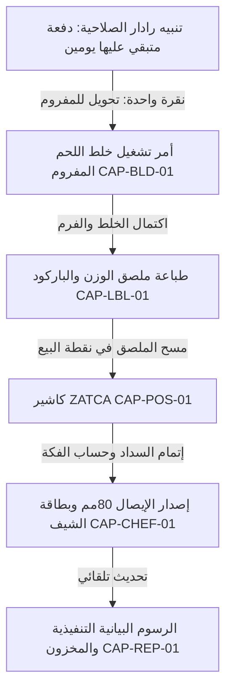

# هندسة التنسيق والربط بين القدرات — Phase 3: Feature Orchestration
**مشروع S.kosif**  
**تاريخ التوثيق:** 25 سبتمبر 2026  
**المرجع:** MASTER REBUILD DIRECTIVE (المرحلة 3)

---

## 1. فلسفة التنسيق البيني (Orchestration Philosophy)
الهدف الأساسي من هذه المرحلة هو **منع تحول المنظومة إلى جزر معزولة أو شاشات منفصلة**. تجربة المستخدم يجب أن تتدفق بسلاسة من إجراء إلى الإجراء التالي المنطقي دون أن يضطر المستخدم للبحث اليدوي.

---

## 2. السياق المشترك المستمر (Shared Context Architecture)

يحافظ التطبيق على سياق تشغيلي موحد عبر كافة الشاشات:

```javascript
const AppContext = {
  // المنشأة والفرع
  activeTenant: "aghnam_alwadi",
  activeBranch: "main_butchery",
  
  // حالة المستودع والأسعار
  unlocked: true,
  theme: "heritage", // ثيم تراث الوادي الافتراضي
  
  // الكيان النشط قيد المعالجة (Active Entity)
  currentBatch: null,      // دفعة اللحوم أو التعتيق المحددة
  currentCustomer: null,   // العميل المحدد في الكاشير
  currentCarcass: null,    // الذبيحة الجاري تشفيتها
  
  // مرشحات البحث والتقارير
  timeRange: "today",      // today, week, month, custom
  activeCurrency: "SAR",
  vatRate: 0.15
};
```

- عند تغيير أي متغير سياقي (مثل الفترة الزمنية أو العميل)، تستجيب كافة المكونات المعتمدة تلقائياً دون إعادة تحميل الصفحة.

---

## 3. المصدر الموحد للحقيقة (Single Source of Truth - SSOT)

| الكيان (Entity) | المصدر المعتمد (Authoritative Source) | التخزين المؤقت (Cache) | سياسة التحديث والإلغاء (Invalidation Strategy) |
|---|---|---|---|
| **أسعار الكتالوج والذبائح** | `Encrypted Master Catalog` (مفكوك بكلمة المرور) | In-Memory Object (`EXCEL_REF`) | غير قابل للتعديل أثناء الجلسة إلا بإعادة الفتح |
| **دفعات تعتيق اللحوم** | `localStorage['skosif_aging_batches']` | In-Memory Array | تحديث فوري عند تسجيل وزن أو إنهاء دفعة |
| **سجلات الصلاحية والمخزون**| `localStorage['skosif_meat_expiry']` | In-Memory Array | تحديث يومي أو عند تسجيل استلام جديد |
| **فواتير المبيعات ZATCA** | `localStorage['skosif_zatca_invoices']` | In-Memory Array | إلحاق مستمر مع كل عملية كاشير ناجحة |
| **مخصصات التشفية (Cuts)** | `localStorage['sk37_cuts']` | In-Memory Array | حفظ فوري عند تعديل نسب العائد أو أسعار البيع |

---

## 4. تدفق العمليات بين القدرات (Feature-to-Feature Flow)



---

## 5. التنقل السياقي الذكي (Contextual Navigation)

من أي مكان في التطبيق:
1. **من شاشة رادار الصلاحية:** إمكانية الانتقال المباشر إلى *أمر تشغيل المفرمة* بالكمية المحددة للدفعة دون إعادة كتابة البيانات.
2. **من تجربة تشفية الذبيحة:** إمكانية إصدار *ملصقات أسعار الموازين* لكافة القطعيات الناتجة دفعة واحدة.
3. **من شاشة الكاشير:** إمكانية فتح *فك شفرة TLV* للتحقق من أي فاتورة، أو إرسال *بطاقة نصائح الطهي* للعميل عبر واتساب.
4. **من غرف التعتيق:** الانتقال المباشر لحساب *تكلفة القطعية المعتقة* بعد إدخال وزن قشرة التعتيق.

---

## 6. نظام الإشعارات والتغذية الراجعة الموحد (Unified Feedback System)

ممنوع استخدام `alert()` أو `confirm()` المتزامنة التي تجمد المتصفح كحل افتراضي.
يعتمد النظام على:
- **Toast Notifications:** إشعارات عائمة غير حاجزة تختفي خلال 3 ثوانٍ للعمليات الروتينية (مثل: "تم حفظ الفاتورة بنجاح", "F2: فاتورة ZATCA 🧾").
- **Inline Field Validation:** تنبيهات فورية داخل حقول الإدخال مع تلوين الحواف وتوضيح السبب (مثل: "نسبة الهدر يجب أن تكون أقل من 100%").
- **Modal Confirmation Sheets:** نوافذ تأكيد منبثقة مصممة للأفعال التدميرية فقط (مثل: استعادة قاعدة البيانات وحذف السجلات الحالية).
- **Audio Feedback (اختياري للكاشير):** صوت نغمة خفيف عند مسح الباركود بنجاح وصوت تنبيه مميز عند الخطأ لسرعة التعامل في بيئة العمل السريعة.

---

## 7. تصنيف ومعالجة الأخطاء (Error Taxonomy & UX Strategy)

| فئة الخطأ | مثال واقعي | السلوك البرمجي وتجربة المستخدم (UX Behavior) |
|---|---|---|
| **User Validation** | إدخال وزن سالب أو هدر 100% | إبراز الحقل باللون الأحمر ومنع الحساب مع رسالة توجيهية فورية أسفل الحقل |
| **Data Integrity** | استدعاء قطعية غير موجودة في الكتالوج | تسجيل الخطأ في السجل وإرجاع قيمة افتراضية آمنة دون انهيار الواجهة |
| **Hardware / Scanner** | عدم السماح باستخدام كاميرا الجوال للباركود | عرض حقل إدخال يدوي بديل للباركود تلقائياً مع توضيح سبب تعذر الكاميرا |
| **Printer / Export** | حظر النوافذ المنبثقة عند طباعة أمر التشفية | إشعار Toast لطيف يطلب السماح بالنوافذ لطباعة المستند |
| **System Security** | إدخال كلمة مرور خاطئة في شاشة القفل | اهتزاز بصري خفيف (Shake Animation) مع مسح الحقل وإظهار تنبيه دون كشف تفاصيل الأمان |
| **Concurrency Conflict** | تعارض تعديل مراجعة مساحة العمل | إشعار بوجود تحديث أحدث مع إمكانية دمج التعديلات دون فقدان البيانات |
